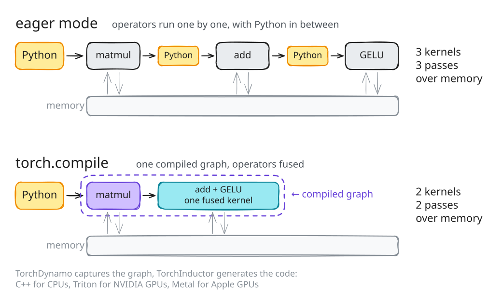
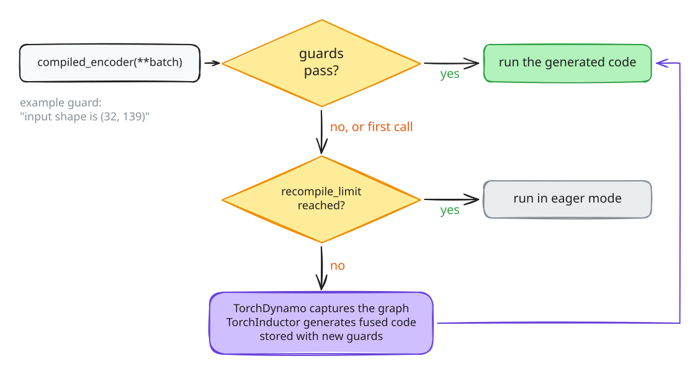
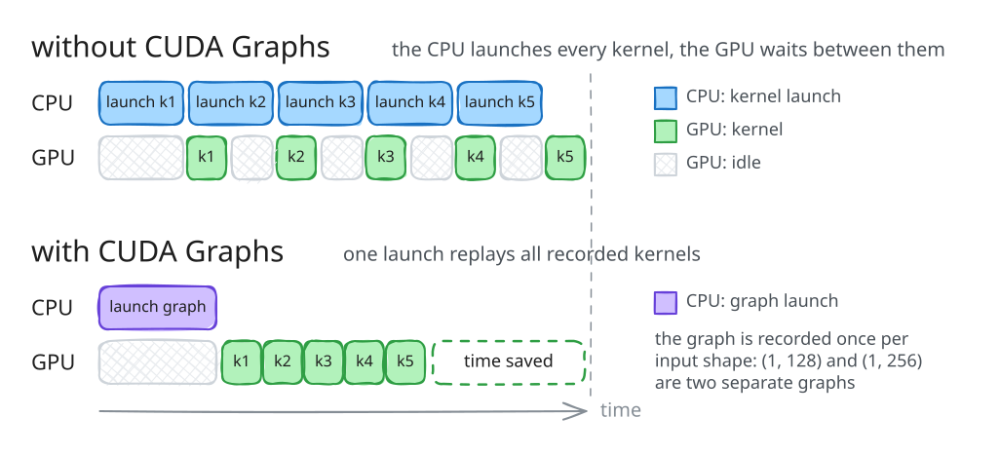

# Laboratory 7 instruction

## Introduction

This lab covers optimizing models for inference: making the same model answer faster, use less memory,
and run on cheaper hardware. In production, a model runs for every request, for months, so inference
usually costs much more than training. We will follow one rule throughout the lab: **measure first, then
optimize**. Most optimizations help only on some hardware and for some inputs, and the only way to know is
to measure them.

We will start with a sentence embedding model,
[multi-qa-mpnet-base-cos-v1](https://huggingface.co/sentence-transformers/multi-qa-mpnet-base-cos-v1)
(110M parameters), which turns a text into a 768-dimensional vector. We will measure it, profile it, compile
it with `torch.compile`, export it to ONNX, run it with ONNX Runtime and quantize it. Then we will move to a
small language model, [Qwen3-0.6B](https://huggingface.co/Qwen/Qwen3-0.6B), and see why text generation is
slow and what the KV cache does about it. Serving LLMs at scale is the topic of a later lab.

On Linux, PyTorch from PyPI includes CUDA libraries, so the first `uv sync` downloads a few GB. The models
take about 1.7 GB of disk space. The main part of the lab runs on CPU, so any laptop works. Some exercises
also use a GPU if there is one: an NVIDIA GPU (CUDA) or an Apple Silicon GPU (MPS). The last section, GPU
inference, is optional and needs one of them. Google Colab with a GPU runtime works too.

```python
import os

# gets rid of irritating warnings
os.environ["TOKENIZERS_PARALLELISM"] = "false"

import time

import numpy as np
import torch
from transformers import AutoModel, AutoTokenizer

# a fixed number of threads makes measurements repeatable and comparable between libraries
torch.set_num_threads(4)


def get_device() -> torch.device:
    if torch.cuda.is_available():
        return torch.device("cuda")
    if torch.backends.mps.is_available():
        return torch.device("mps")
    return torch.device("cpu")


print("PyTorch", torch.__version__, "| accelerator:", get_device())
```

We use 4 threads everywhere. If your CPU has fewer physical cores, set it to their number.

## Measuring inference performance

Before optimizing anything, we need a reliable way to measure the speed. The naive approach is to call
`time.time()` before and after a single call of the model. It is not enough, because:

- the first calls are slower, as libraries allocate memory, load kernels and fill caches, so we need a
  **warmup**
- a single measurement is noisy, so we need many runs
- GPUs run asynchronously: the Python call returns before the computation finishes, so we have to
  **synchronize** with the device before reading the clock
- the average hides slow requests, which users notice the most, so we look at percentiles

There are two different goals, and each has its own metric:

- **latency** - time to answer one request, important for online services; we report the median (p50) and
  the 95th percentile (p95)
- **throughput** - how many inputs we process per second, important for batch jobs, e.g. embedding a whole
  document database

### Benchmarking

Let's write a small helper that we will use for all measurements in this lab:

```python
def synchronize(device: torch.device) -> None:
    # GPU calls are asynchronous, wait until the queued work is done
    if device.type == "cuda":
        torch.cuda.synchronize()
    elif device.type == "mps":
        torch.mps.synchronize()


def benchmark(
    fn, n_runs: int = 20, n_warmup: int = 3, device: torch.device | str = "cpu"
) -> dict[str, float]:
    device = torch.device(device)
    for _ in range(n_warmup):
        fn()
    synchronize(device)
    times = []
    for _ in range(n_runs):
        start = time.perf_counter()
        fn()
        synchronize(device)
        times.append(time.perf_counter() - start)
    times_ms = np.array(times) * 1000
    return {"p50_ms": float(np.percentile(times_ms, 50)), "p95_ms": float(np.percentile(times_ms, 95))}
```

A few things to note:

- `time.perf_counter()` is a monotonic, high-resolution clock, meant for measuring durations
- `fn` is any function without arguments, so the same helper works for PyTorch and ONNX Runtime
- PyTorch has a more complete tool, [torch.utils.benchmark](https://docs.pytorch.org/docs/stable/benchmark_utils.html),
  which also handles threads and warmup; our helper is simpler and gives percentiles

Now let's load the model. A sentence embedding is the mean of the token embeddings (ignoring padding),
normalized to length 1, as described in the [model card](https://huggingface.co/sentence-transformers/multi-qa-mpnet-base-cos-v1).
We wrap the transformer and the pooling in one module, so that every optimization in this lab works on the
whole computation, from token IDs to the final embedding:

```python
MODEL_NAME = "sentence-transformers/multi-qa-mpnet-base-cos-v1"


class SentenceEncoder(torch.nn.Module):
    def __init__(self, model: torch.nn.Module) -> None:
        super().__init__()
        self.model = model

    def forward(self, input_ids: torch.Tensor, attention_mask: torch.Tensor) -> torch.Tensor:
        hidden = self.model(input_ids=input_ids, attention_mask=attention_mask).last_hidden_state
        # mean pooling over real tokens only, padding positions have mask 0
        mask = attention_mask.unsqueeze(-1).to(hidden.dtype)
        embeddings = (hidden * mask).sum(dim=1) / mask.sum(dim=1).clamp(min=1e-9)
        return torch.nn.functional.normalize(embeddings, dim=-1)


tokenizer = AutoTokenizer.from_pretrained(MODEL_NAME)
encoder = SentenceEncoder(AutoModel.from_pretrained(MODEL_NAME)).eval()
```

For speed, only the length of a text matters, not its content. So instead of downloading a dataset, we
generate 256 texts of different lengths by joining random sentences:

```python
SENTENCES = [
    "How do I reset my password?",
    "The hotel was close to the station and the staff were very helpful.",
    "Quantization stores model weights with fewer bits, which makes the model smaller.",
    "Breakfast was fine.",
    "What is the capital of Poland?",
    "We waited almost an hour for our table, and when the food finally arrived it was cold.",
    "ONNX Runtime can run the same model on CPUs, GPUs and dedicated accelerators.",
    "Thanks!",
    "Can I bring my dog to the apartment if I pay an extra cleaning fee?",
    "The room was small, but clean, quiet and had everything we needed for a short stay.",
]


def make_texts(n: int, seed: int = 0) -> list[str]:
    rng = np.random.default_rng(seed)
    return [" ".join(rng.choice(SENTENCES, size=rng.integers(1, 9))) for _ in range(n)]


texts = make_texts(256)
lengths = [len(tokenizer(text)["input_ids"]) for text in texts]
print(f"tokens per text: min {min(lengths)}, median {np.median(lengths):.0f}, max {max(lengths)}")
```

Let's measure the latency of a single text, and the throughput for a batch of 32 texts:

```python
single = tokenizer(texts[:1], padding=True, truncation=True, return_tensors="pt")
batch = tokenizer(texts[:32], padding=True, truncation=True, return_tensors="pt")

with torch.inference_mode():
    result_single = benchmark(lambda: encoder(**single))
    result_batch = benchmark(lambda: encoder(**batch), n_runs=10)

print("single text:", result_single)
print("batch of 32:", result_batch, f"-> {32 / result_batch['p50_ms'] * 1000:.0f} texts/s")
```

### Inference mode

Two PyTorch settings matter for inference:

- **evaluation mode**, `model.eval()` - switches off dropout and makes batch normalization use the
  statistics collected during training; it changes what the model computes, not whether gradients are
  tracked
- **disabling gradients** - during inference we never call `backward()`, so there is no need to record the
  operations and keep intermediate results for it; [torch.no_grad()](https://docs.pytorch.org/docs/stable/generated/torch.no_grad.html)
  turns this off, and [torch.inference_mode()](https://docs.pytorch.org/docs/stable/generated/torch.autograd.grad_mode.inference_mode.html)
  additionally skips the bookkeeping for in-place operations and views

`inference_mode()` is stricter: tensors created inside it can never be used in autograd later. For pure
inference, this is exactly what we want. See [grad modes](https://docs.pytorch.org/docs/stable/notes/autograd.html#grad-modes)
in the PyTorch docs for details.

Hugging Face `from_pretrained()` already returns the model in evaluation mode, but every new
`torch.nn.Module`, like our wrapper, starts in training mode. That is why we called `eval()` when creating
`encoder`. Let's check it, and see what happens in training mode:

```python
print("transformer in training mode after loading:", encoder.model.training)
print("wrapper in training mode after eval():", encoder.training)

encoder.train()
with torch.no_grad():
    first, second = encoder(**single), encoder(**single)
print("train mode, the same embedding twice:", torch.allclose(first, second))

encoder.eval()
with torch.no_grad():
    first, second = encoder(**single), encoder(**single)
print("eval mode, the same embedding twice:", torch.allclose(first, second))
```

In training mode, dropout zeroes random activations, so the same text gets a different embedding every
time. So `eval()` is first of all a matter of correctness, and only then of speed.

#### Exercise 1 (1 point)

Measure the time of the batch of 32 texts (`batch`) in four settings:
1. `encoder.train()`, gradients enabled
2. `encoder.eval()`, gradients enabled
3. `encoder.eval()` and `torch.no_grad()`
4. `encoder.eval()` and `torch.inference_mode()`

Report p50 and p95 for each setting, and the speedup of settings 2-4 over setting 1 (time of setting 1
divided by the time of the given setting). Which change gives the largest speedup, and why? Is there a
difference between `no_grad()` and `inference_mode()` for this model? Remember to call `encoder.eval()` at
the end, the rest of the lab assumes evaluation mode.

```python
```

// comment here

---

### Profiling

A benchmark tells us how long something takes. A **profiler** tells us where the time goes, so that we
optimize the right part. [torch.profiler](https://docs.pytorch.org/docs/stable/profiler.html) records every
PyTorch operator call, with its time and input shapes. We can also mark our own code blocks with
`record_function()`, e.g. to separate tokenization from the model:

```python
from torch.profiler import ProfilerActivity, profile, record_function


def embed(texts: list[str]) -> torch.Tensor:
    with record_function("tokenize"):
        inputs = tokenizer(texts, padding=True, truncation=True, return_tensors="pt")
    with record_function("forward"):
        return encoder(**inputs)


with torch.inference_mode():
    embed(texts[:32])  # warmup
    with profile(activities=[ProfilerActivity.CPU], record_shapes=True) as prof:
        embed(texts[:32])

print(prof.key_averages().table(sort_by="self_cpu_time_total", row_limit=10))
prof.export_chrome_trace("trace.json")
```

A few things to note:

- **self CPU time** is the time spent in the operator itself, **CPU total** also includes the operators it
  called; sorting by self time shows the real hotspots
- `aten::addmm` and `aten::bmm` are matrix multiplications: `addmm` in linear layers, `bmm` in attention
- `trace.json` is a timeline of all calls; open it in [Perfetto](https://ui.perfetto.dev) (drag and drop
  the file) to see the `tokenize` and `forward` blocks and the operators inside them
- we profile on CPU, which is also our deployment target later in this lab; `torch.profiler` can also record
  CUDA kernels with `ProfilerActivity.CUDA`

In a batch, all texts are padded to the longest one. The model computes the padding tokens like any other
and only then the attention mask hides them, so every padding token is wasted work. We can measure the
**padding waste** as the fraction of padding positions in the batch:

```python
def padding_waste(batch_texts: list[str]) -> float:
    mask = tokenizer(batch_texts, padding=True, truncation=True, return_tensors="pt")["attention_mask"]
    return 1 - mask.sum().item() / mask.numel()


print(f"padding waste of the first batch: {padding_waste(texts[:32]):.1%}")
```

#### Exercise 2 (1 point)

1. Based on the profile above, which 3 operators take the most self CPU time? How much time does
   tokenization take, compared to the forward pass? Tip: look for the `tokenize` and `forward` rows in
   `prof.key_averages()`, or in the Perfetto timeline.
2. Split `texts` into 8 batches of 32 texts, in their original order. Compute the mean padding waste and
   the throughput (texts/s) of embedding all 256 texts with `embed()`.
3. Sort the texts by token length, split them into batches again, and compute the same two numbers. In a
   real service, the caller expects embeddings in the original order, so return them in that order. Tip:
   `np.argsort()`.
4. How much faster is the sorted version? Is the speedup proportional to the reduction of padding waste?

```python
```

// comment here

---

## Model compilation

In eager mode, PyTorch runs operators one by one, as Python calls them. [torch.compile](https://docs.pytorch.org/docs/stable/generated/torch.compile.html)
captures the whole computation as a graph (TorchDynamo) and generates optimized code for it (TorchInductor):
C++ for CPU, Triton kernels for NVIDIA GPUs, and Metal kernels for Apple GPUs. The main gains come from
**fusing** operators, e.g. computing an addition and GELU in one pass over memory instead of two, and from
removing the Python overhead between operators.



```python
compiled_encoder = torch.compile(encoder)

with torch.inference_mode():
    start = time.perf_counter()
    compiled_output = compiled_encoder(**batch)
    print(f"first call, with compilation: {time.perf_counter() - start:.1f} s")

    eager_output = encoder(**batch)
    print("max difference from eager:", (compiled_output - eager_output).abs().max().item())
    print("eager:   ", benchmark(lambda: encoder(**batch), n_runs=10))
    print("compiled:", benchmark(lambda: compiled_encoder(**batch), n_runs=10))
```

A few things to note:

- compilation happens on the first call and takes from seconds to minutes; for a long-running server it is
  paid once, for a short script it can cost more than it saves
- the results are numerically close to eager mode, but not bit-identical, because fused kernels can sum
  numbers in a different order
- compile the model after `eval()`, so that the graph contains only inference operations

How much `torch.compile` helps depends on the hardware and the model. Our model spends most of its time in
matrix multiplications, which already use optimized libraries in eager mode. On an Apple M1 Pro CPU, the
compiled model is about as fast as the eager one, while on the M1 Pro GPU (MPS) it is about 1.4 times
faster.

The generated code is specialized for the input shapes it has seen, and protected by **guards**: conditions
checked on every call, like "the input has shape (32, 139)". When a guard fails, PyTorch compiles again. By
default, after the first shape change, it recompiles the model with dynamic sizes, so that later changes do
not need a recompilation. With `torch.compile(model, dynamic=True)`, it compiles with dynamic sizes from the
start. After `torch._dynamo.config.recompile_limit` recompilations (8 by default), PyTorch gives up and runs
this code in eager mode. `torch._logging.set_logs(recompiles=True)` logs every recompilation and its reason.



Note that tensors created inside `torch.inference_mode()` are a different kind of tensor (inference
tensors), and switching between them and normal tensors also triggers a recompilation. See the
[torch.compiler docs](https://docs.pytorch.org/docs/stable/torch.compiler.html) for more details.

#### Exercise 3 (1 point)

1. Measure the compilation time (first call) and p50 of the batch of 32 texts for the eager and compiled
   encoder on CPU.
2. If you have a GPU (CUDA or MPS), repeat it there: move a copy of the encoder and the inputs to
   `get_device()`, and pass `device=` to `benchmark()`, so that it synchronizes.
3. With recompilation logs enabled, call the compiled CPU encoder with batches of 16, 8 and 4 texts,
   measuring the first and the second call for each. Which calls recompiled the model, and why? Then compile
   a new copy with `dynamic=True` and repeat. Tip: `torch._logging.set_logs(recompiles=False)` turns the
   logs off. All copies of `SentenceEncoder` share the same `forward()` code, and the recompilation limit counts
   them together, so call `torch._dynamo.reset()` before compiling a new copy.
4. Would you use `torch.compile` for this model in production on your hardware? Consider a long-running
   server and a job started for each request.

```python
```

// comment here

---

## ONNX and ONNX Runtime

[ONNX](https://onnx.ai) (Open Neural Network Exchange) is a file format that describes a model as a graph
of standard operators (`MatMul`, `Softmax`, `LayerNormalization`, ...) together with its weights. Any
framework can export to it, and any runtime that implements the operators can run it.
[ONNX Runtime](https://onnxruntime.ai) (ORT) is the most popular such runtime. It has a few advantages for
deployment:

- **framework- and language-agnostic** - export the model from PyTorch in Python, and run it from C++,
  Java, C# or JavaScript, without PyTorch
- **graph optimizations** - ORT rewrites the graph before running it, e.g. fuses operators
- **hardware backends** - the same file runs on CPUs, NVIDIA GPUs, Intel accelerators, Apple Neural
  Engine and other hardware, through execution providers
- **lightweight deployment** - the `onnxruntime` package is tens of MB, while PyTorch is hundreds of MB
  for CPU and a few GB with CUDA; this means smaller Docker images and faster cold starts

### Exporting to ONNX

[torch.onnx.export()](https://docs.pytorch.org/docs/stable/onnx.html) captures the model graph with
`torch.export`, and translates every PyTorch operator into ONNX operators. It needs an example input, which
it runs through the model:

```python
sample = tokenizer(["This is a sample input text for ONNX export."], return_tensors="pt")

onnx_program = torch.onnx.export(
    encoder,
    (sample["input_ids"], sample["attention_mask"]),
    "model.onnx",
    input_names=["input_ids", "attention_mask"],
    output_names=["sentence_embedding"],
    dynamic_shapes={
        "input_ids": {0: "batch", 1: "sequence"},
        "attention_mask": {0: "batch", 1: "sequence"},
    },
    report=True,
    verify=True,
)
```

A few things to note:

- we export the whole `SentenceEncoder`, with pooling and normalization, so the ONNX model returns final
  sentence embeddings, and the inference code does not need PyTorch at all
- `dynamic_shapes` marks the batch size (axis 0) and the sequence length (axis 1) as dynamic, and names
  them; without it, the model would accept only inputs of exactly the same shape as the example; the
  exporter may warn that an axis name "will not be used", because both inputs share the same axes, but the
  names still end up in the file
- the weights are saved in a separate file, `model.onnx.data`, next to `model.onnx`, which holds only the
  graph; always copy both files together
- `verify=True` runs the exported model with ONNX Runtime and compares its outputs with PyTorch, and
  `report=True` writes a Markdown report (`onnx_export_*.md`) with the graph and the verification results
- every ONNX file declares an **opset**, the version of the operator set it uses; by default the exporter
  uses opset 20, and `opset_version` selects another one; choose a version that your runtime supports

Let's look at the exported files and the graph:

```python
from collections import Counter
from pathlib import Path

import onnx

for path in sorted(Path(".").glob("model.onnx*")):
    print(f"{path.name}: {path.stat().st_size / 1e6:.1f} MB")

onnx_model = onnx.load("model.onnx", load_external_data=False)
print("opset:", onnx_model.opset_import[0].version)
for value in [*onnx_model.graph.input, *onnx_model.graph.output]:
    dims = [d.dim_param or d.dim_value for d in value.type.tensor_type.shape.dim]
    print(f"{value.name}: {dims}")
print("number of nodes:", len(onnx_model.graph.node))
print(Counter(node.op_type for node in onnx_model.graph.node).most_common(8))
```

To see the graph, open `model.onnx` in [Netron](https://netron.app). Attention in our model is a sequence
of `MatMul`, `Softmax` and `MatMul` nodes. Models that use PyTorch's fused attention
(`scaled_dot_product_attention`) and are exported with `opset_version=23` or higher get a single `Attention`
node instead.

### Running with ONNX Runtime

To run the model, we create an `InferenceSession`. ONNX Runtime works with NumPy arrays, so the tokenizer
returns NumPy arrays (`return_tensors="np"`):

```python
import onnxruntime as ort


def make_session(
    path: str,
    level: ort.GraphOptimizationLevel = ort.GraphOptimizationLevel.ORT_ENABLE_ALL,
    optimized_path: str | None = None,
) -> ort.InferenceSession:
    options = ort.SessionOptions()
    options.graph_optimization_level = level
    # the same number of threads as PyTorch, for a fair comparison
    options.intra_op_num_threads = 4
    if optimized_path:
        options.optimized_model_filepath = optimized_path
    return ort.InferenceSession(path, sess_options=options, providers=["CPUExecutionProvider"])


session = make_session("model.onnx")
single_np = dict(tokenizer(texts[:1], padding=True, truncation=True, return_tensors="np"))
batch_np = dict(tokenizer(texts[:32], padding=True, truncation=True, return_tensors="np"))

onnx_output = session.run(None, batch_np)[0]
with torch.inference_mode():
    torch_output = encoder(**batch).numpy()
np.testing.assert_allclose(onnx_output, torch_output, atol=1e-5)

print("single text:", benchmark(lambda: session.run(None, single_np)))
print("batch of 32:", benchmark(lambda: session.run(None, batch_np), n_runs=10))
```

Compare those numbers with PyTorch from the beginning of the lab. The result depends a lot on the CPU. On
Apple Silicon, PyTorch uses Apple's Accelerate library, which runs matrix multiplications on a dedicated
matrix unit, and is faster than ONNX Runtime in float32: on an M1 Pro, 0.65 s vs 2.4 s for the batch.
After quantization, which we will do in a moment, ONNX Runtime is faster than PyTorch for single texts even
there.

### Graph optimizations

When ONNX Runtime creates a session, it optimizes the graph. The
[optimizations](https://onnxruntime.ai/docs/performance/model-optimizations/graph-optimizations.html) are
grouped into levels, and each level includes the previous ones:

- `ORT_ENABLE_BASIC` - rewrites that keep the semantics and remove redundant work, e.g. constant folding,
  removing identity operations
- `ORT_ENABLE_EXTENDED` - fusions of operator patterns into faster kernels, e.g. `Add` and
  `LayerNormalization` into `SkipLayerNormalization`
- `ORT_ENABLE_LAYOUT` - changes of the memory layout of tensors, mostly for convolutions on CPU
- `ORT_ENABLE_ALL` - all of the above, the default

`ORT_DISABLE_ALL` turns optimizations off. The optimizations can run in two modes:

- **online** - every time a session is created, the default; convenient, but repeats the work at every
  start of the application
- **offline** - once, with `SessionOptions.optimized_model_filepath` set, which saves the optimized graph
  to a file; later, the application loads this file with optimizations disabled

Let's check what each level does to our graph:

```python
def check_level(level_name: str) -> None:
    level = getattr(ort.GraphOptimizationLevel, level_name)
    optimized_path = f"model_{level_name.lower()}.onnx"
    start = time.perf_counter()
    level_session = make_session("model.onnx", level, optimized_path=optimized_path)
    creation_time = time.perf_counter() - start
    optimized = onnx.load(optimized_path, load_external_data=False)
    result = benchmark(lambda: level_session.run(None, batch_np), n_runs=5)
    print(
        f"{level_name:20s} session {creation_time:.2f} s, {len(optimized.graph.node)} nodes, "
        f"batch p50 {result['p50_ms']:.0f} ms"
    )


for level_name in ["ORT_DISABLE_ALL", "ORT_ENABLE_BASIC", "ORT_ENABLE_EXTENDED", "ORT_ENABLE_ALL"]:
    check_level(level_name)
```

A few things to note:

- ORT warns when it saves a graph with layout optimizations, because such a graph may work only on the
  same type of hardware; for offline optimization, use `ORT_ENABLE_EXTENDED`
- the saved graph still reads the weights from `model.onnx.data`, so keep it in the same directory
- for our small model, creating a session takes a fraction of a second either way; offline optimization
  matters for large models, and for mobile and serverless deployments, where the start time counts

Loading an offline-optimized model looks like this:

```python
offline_session = make_session("model_ort_enable_extended.onnx", ort.GraphOptimizationLevel.ORT_DISABLE_ALL)
np.testing.assert_allclose(offline_session.run(None, batch_np)[0], torch_output, atol=1e-5)
```

### Execution providers

**Execution providers** (EPs) are the backends of ONNX Runtime: each one implements ONNX operators for some
hardware, e.g. `CPUExecutionProvider`, `CUDAExecutionProvider` and `TensorrtExecutionProvider` for NVIDIA
GPUs, `OpenVINOExecutionProvider` for Intel hardware, or `CoreMLExecutionProvider` for Apple GPUs and the
Neural Engine. The ONNX file does not contain any hardware information. When a session is created, ORT
**partitions** the graph: every node goes to the first provider on the list that supports it, and the
remaining nodes go to the CPU. See the [execution providers docs](https://onnxruntime.ai/docs/execution-providers/)
for the full list.

Which providers we have depends on the installed package, e.g. `onnxruntime-gpu` adds CUDA:

```python
print("available providers:", ort.get_available_providers())
for ep_device in ort.get_ep_devices():
    print(ep_device.ep_name, ep_device.device.type)
```

Instead of listing providers by name, we can ask ORT to choose a device by a policy, e.g. prefer an NPU,
prefer a GPU, or prefer the CPU. This way, the same code runs on different machines:

```python
options = ort.SessionOptions()
options.intra_op_num_threads = 4
options.set_provider_selection_policy(ort.OrtExecutionProviderDevicePolicy.PREFER_NPU)
policy_session = ort.InferenceSession("model.onnx", sess_options=options)

print("providers used:", policy_session.get_providers())
print("batch of 32:", benchmark(lambda: policy_session.run(None, batch_np), n_runs=5))
```

On a Mac, `PREFER_NPU` selects CoreML. ORT then logs how the graph was partitioned: CoreML supports only
162 of 449 nodes of our model, split into 65 separate parts, so the data travels back and forth between
the CPU and the accelerator many times per call. The result is more than twice as slow as the CPU alone.
An accelerator helps only when it can run the whole graph, or at least large parts of it. On a machine
without an NPU, ORT falls back to the CPU.

### Quantization

**Quantization** stores numbers with fewer bits. With 8-bit integers (`int8`), the weights take 4 times
less memory than in `float32`, and CPUs with int8 dot-product instructions (VNNI on x86, dot-product
instructions on Arm) also compute faster. A float value is mapped to an integer with a scale and a
zero point: `value = scale * (int_value - zero_point)`. ONNX Runtime has two
[quantization methods](https://onnxruntime.ai/docs/performance/model-optimizations/quantization.html):

- **dynamic quantization** - the weights are quantized once, ahead of time, and the activations are
  quantized on the fly, for every input, based on their actual range; it needs no data, and it is the
  usual choice for transformers on CPU
- **static quantization** - the activation ranges are computed beforehand, on representative calibration
  data, and stored in the model; it is faster at inference, but needs good calibration data, and the model
  is more sensitive to inputs different from that data

The quantization parameters can be computed per tensor (one scale for the whole weight matrix) or **per
channel** (one scale for each output channel), which is more accurate when the channels have different
ranges. Let's quantize our model with dynamic quantization and check its size, speed and quality. Quality
here means how close the int8 embeddings are to the float32 ones, and whether search results stay the same:

```python
from onnxruntime.quantization import QuantType, quantize_dynamic


def model_size_mb(path: str) -> float:
    # the graph file and its external data file, if any
    return sum(p.stat().st_size for p in Path(path).parent.glob(Path(path).name + "*")) / 1e6


def compare_embeddings(reference: np.ndarray, other: np.ndarray) -> str:
    # embeddings are normalized, so the dot product is the cosine similarity
    cosine = (reference * other).sum(axis=-1)
    return f"cosine similarity: mean {cosine.mean():.4f}, min {cosine.min():.4f}"


quantize_dynamic("model.onnx", "model_int8.onnx", weight_type=QuantType.QInt8)
int8_session = make_session("model_int8.onnx")

int8_output = int8_session.run(None, batch_np)[0]
print(f"size: {model_size_mb('model.onnx'):.0f} MB -> {model_size_mb('model_int8.onnx'):.0f} MB")
print(compare_embeddings(onnx_output, int8_output))
print("float32:", benchmark(lambda: session.run(None, batch_np), n_runs=10))
print("int8:   ", benchmark(lambda: int8_session.run(None, batch_np), n_runs=10))
```

`quantize_dynamic()` logs a warning that recommends pre-processing the model with `quant_pre_process()`,
which adds shape information and optimizes the graph before quantization. It does not work with the external
data file of our model, and our model quantizes well without it, so we skip it.

For search, what matters most is the ranking of documents for a query. Let's check whether the top 5 results
for a query stay the same:

```python
def top_k(query_session: ort.InferenceSession, query: str, k: int = 5) -> list[int]:
    query_np = dict(tokenizer([query], return_tensors="np"))
    query_embedding = query_session.run(None, query_np)[0]
    documents = query_session.run(None, batch_np)[0]
    return (documents @ query_embedding.T).ravel().argsort()[::-1][:k].tolist()


print("float32:", top_k(session, "How do I reset my password?"))
print("int8:   ", top_k(int8_session, "How do I reset my password?"))
```

Some layers are more sensitive to quantization than others, and we can leave them in float32 with the
`nodes_to_exclude` argument of `quantize_dynamic()`. To choose them, we need to know which ONNX node comes
from which PyTorch module. The exporter stores this in the node metadata:

```python
import ast


def matmul_modules(path: str) -> dict[str, str]:
    """Map the names of MatMul nodes with weights to the PyTorch modules they come from."""
    graph = onnx.load(path, load_external_data=False).graph
    weights = {initializer.name for initializer in graph.initializer}
    modules = {}
    for node in graph.node:
        if node.op_type == "MatMul" and node.input[1] in weights:
            metadata = {prop.key: prop.value for prop in node.metadata_props}
            # the last scope is the operator, the one before it is the module
            modules[node.name] = ast.literal_eval(metadata["pkg.torch.onnx.name_scopes"])[-2]
    return modules


modules = matmul_modules("model.onnx")
print(len(modules), "MatMul nodes with weights, e.g.:")
for name, module in list(modules.items())[:6]:
    print(f"  {name}: {module}")
```

Many models on the Hugging Face Hub also come with ready ONNX files, including quantized ones, e.g. the
[onnx folder](https://huggingface.co/sentence-transformers/multi-qa-mpnet-base-cos-v1/tree/main/onnx) of our
model.

#### Exercise 4 (1 point)

1. Quantize the model again with `per_channel=True`. Compare the size, the batch p50, the cosine
   similarity to float32 and the top 5 results with the default quantization.
2. Find the group of layers that is responsible for most of the quality loss. Group the nodes from
   `matmul_modules()` by layer type, i.e. the end of the module name: `attention.attn.q`,
   `attention.attn.k`, `attention.attn.v`, `attention.attn.o`, `intermediate.dense` and `output.dense`. Quantize the model with
   `per_channel=True` six times, each time excluding one group with `nodes_to_exclude`, and compare the
   cosine similarity. Which group matters the most? Tip: look at what comes before that layer in the model.
3. Make a table with float32, int8, int8 per channel, and int8 per channel without the most sensitive group:
   size, batch p50, single text p50, mean and min cosine similarity. Which version would you deploy, and
   why?

```python
```

// comment here

---

## Small language models

Embedding a text needs one forward pass. A language model generates text **token by token**, and each new
token needs a forward pass over the model. Generation has two phases:

- **prefill** - the model processes the whole prompt at once; this is a lot of computation, done in
  parallel for all prompt tokens, and it determines the **time to first token** (TTFT)
- **decode** - the model generates the next tokens one by one; each step does little computation, but
  reads all the weights from memory, so its speed is limited by the **memory bandwidth**; it determines the
  **time per output token** (TPOT)

This gives a useful estimate: tokens/s in decode is at most memory bandwidth / model size in bytes. For
example, a 0.6B parameter model in 16-bit precision has about 1.2 GB of weights, so on a laptop with
100-200 GB/s of memory bandwidth, it can generate at most 80-170 tokens/s. This is why smaller and quantized
models generate faster, even when the hardware has plenty of compute.

We will measure three numbers:

- **TTFT** - time from the request to the first token
- **TPOT** - average time of each next token: (total time - TTFT) / (number of tokens - 1)
- **tokens/s** - the number of generated tokens / total time

Let's load [Qwen3-0.6B](https://huggingface.co/Qwen/Qwen3-0.6B), a small open model (Apache 2.0 license).
On a GPU, we use 16-bit weights, on CPU 32-bit ones, because most CPUs are slow with 16-bit floats.
Qwen3 can "think" before answering, which we turn off to get short, comparable answers:

```python
from transformers import AutoModelForCausalLM

SLM_NAME = "Qwen/Qwen3-0.6B"
slm_device = get_device()
if slm_device.type == "cuda":
    slm_dtype = torch.bfloat16 if torch.cuda.is_bf16_supported() else torch.float16
elif slm_device.type == "mps":
    slm_dtype = torch.float16
else:
    slm_dtype = torch.float32

slm_tokenizer = AutoTokenizer.from_pretrained(SLM_NAME)
slm = AutoModelForCausalLM.from_pretrained(SLM_NAME, dtype=slm_dtype).to(slm_device).eval()

messages = [{"role": "user", "content": "Explain in a few sentences why quantization speeds up inference."}]
prompt = slm_tokenizer.apply_chat_template(
    messages, tokenize=False, add_generation_prompt=True, enable_thinking=False
)
prompt_inputs = slm_tokenizer([prompt], return_tensors="pt").to(slm_device)

with torch.inference_mode():
    output_ids = slm.generate(**prompt_inputs, max_new_tokens=64, do_sample=False)
answer_ids = output_ids[0, prompt_inputs["input_ids"].shape[1]:]
print(slm_tokenizer.decode(answer_ids, skip_special_tokens=True))
```

To measure TTFT, we generate a single token, which is the prefill alone. Then we generate `n_tokens` tokens,
and compute TPOT from the difference. `min_new_tokens` makes sure that the model does not stop early:

```python
def measure_generation(n_tokens: int = 64, **generate_kwargs) -> dict[str, float]:
    def generate(n: int) -> None:
        slm.generate(
            **prompt_inputs, max_new_tokens=n, min_new_tokens=n, do_sample=False, **generate_kwargs
        )

    with torch.inference_mode():
        generate(1)  # warmup
        generate(n_tokens)
        synchronize(slm_device)
        start = time.perf_counter()
        generate(1)
        synchronize(slm_device)
        ttft = time.perf_counter() - start
        start = time.perf_counter()
        generate(n_tokens)
        synchronize(slm_device)
        total = time.perf_counter() - start
    return {
        "ttft_ms": ttft * 1000,
        "tpot_ms": (total - ttft) / (n_tokens - 1) * 1000,
        "tokens_per_s": n_tokens / total,
    }


print(measure_generation())
```

### KV cache

In attention, every new token looks at all previous tokens, through their **keys** and **values**. They do
not change once computed, so instead of computing them again at every step, the model keeps them in memory,
in the **KV cache**. Without the cache, each step processes the whole sequence again, and generation slows
down as the text grows. With the cache, each step processes only the new token. The price is memory: for
every token, every layer stores a key and a value vector for each KV head:

```text
KV cache size = 2 * layers * KV heads * head dimension * tokens * bytes per value
```

The [transformers library](https://huggingface.co/docs/transformers/kv_cache) has a few cache
implementations:

- `DynamicCache` - the default; it grows with every generated token
- static cache (`cache_implementation="static"`) - allocates memory for the maximum length up front; the
  tensor shapes stay the same at every step, so the model can be compiled with `torch.compile` without
  recompiling at every step

To combine a static cache with compilation, we compile the forward pass of the model and disable the
compilation built into `generate()`, so that the code works the same on every device. See the
[LLM inference optimization](https://huggingface.co/docs/transformers/llm_optims) guide for more details.

```python
# compilation happens during the warmup in measure_generation(), it takes up to a minute
slm.forward = torch.compile(slm.forward)
print(measure_generation(cache_implementation="static", disable_compile=True))
```

On an Apple M1 Pro GPU, the static cache with compilation generates about 110 tokens/s, against about 78
tokens/s with `DynamicCache`.

Note that a static cache reserves memory for the maximum length of every sequence. For a single user this is
fine, but a server that keeps one cache per request quickly runs out of memory. LLM servers like
[vLLM](https://docs.vllm.ai/en/stable/) split the cache into small blocks and give them to requests as they
grow (PagedAttention), which is the topic of the [LLMOps lab](../lab13/LAB_INSTRUCTION.md).

#### Exercise 5 (1 point)

1. Reload the model, so that it is not compiled, and measure TTFT, TPOT and tokens/s for 64 new tokens
   without the cache (`use_cache=False`), and with `DynamicCache` (the default). Then compile it and measure
   the static cache, like above. Put the results in one table.
2. Measure TPOT without the cache and with `DynamicCache` for 256 new tokens. How does it change compared to
   64 tokens, and why?
3. Compute the KV cache size of Qwen3-0.6B in your precision for one sequence of 4096 tokens, and for 32
   such sequences processed in parallel. The values are in `slm.config` (`num_hidden_layers`,
   `num_key_value_heads`, `head_dim`). Compare them with the size of the model weights.
4. Find the memory bandwidth of your device, and estimate the maximum decode tokens/s, as described above.
   How close is your best measurement?

```python
```

// comment here

---

## GPU inference (optional)

This section needs an NVIDIA GPU (CUDA) or an Apple Silicon GPU (MPS). If you have neither, you can run
it in Google Colab with a GPU runtime.

### Lower precision

GPUs compute much faster in 16-bit precision than in 32-bit, and 16-bit weights also take half the memory
and memory bandwidth. There are two 16-bit formats:

- `float16` - more precision bits, but a small range of values; very large activations can overflow
- `bfloat16` - the same range as `float32`, with fewer precision bits; safer for neural networks, but
  needs newer hardware

NVIDIA GPUs have dedicated **Tensor Cores** for 16-bit matrix multiplications, from compute capability 7.0
(e.g. V100, T4) for `float16`, and from 8.0 (e.g. A100, RTX 30xx) for `bfloat16`. We can load the model in
16-bit precision directly, or keep it in `float32` and let [autocast](https://docs.pytorch.org/docs/stable/amp.html)
run each operation in the precision that is safe for it. Note that only floating point tensors change
precision: `input_ids` and `attention_mask` stay integers.

```python
gpu = get_device()
if gpu.type == "cuda":
    print("compute capability:", torch.cuda.get_device_capability(), "| bfloat16:", torch.cuda.is_bf16_supported())

if gpu.type != "cpu":
    # dict comprehension creates new tensors; BatchEncoding.to() would move `batch` itself
    batch_gpu = {key: value.to(gpu) for key, value in batch.items()}
    encoder_fp16 = SentenceEncoder(AutoModel.from_pretrained(MODEL_NAME, dtype=torch.float16)).eval().to(gpu)

    with torch.inference_mode():
        fp16_output = encoder_fp16(**batch_gpu).float().cpu().numpy()
        print(compare_embeddings(torch_output, fp16_output))
        print("float16:", benchmark(lambda: encoder_fp16(**batch_gpu), n_runs=10, device=gpu))
```

### CUDA Graphs and pinned memory

On a GPU, every operator is a separate **kernel launch**, which costs a few microseconds of CPU time. For
small inputs, the GPU can finish a kernel faster than the CPU launches the next one. A
[CUDA Graph](https://docs.pytorch.org/docs/stable/notes/cuda.html#cuda-graphs) records the whole sequence
of kernels once, and then replays it with a single launch. `torch.compile(model, mode="reduce-overhead")`
does this automatically.

A recorded graph works only for the input shapes it was recorded with. A new shape means recording a new
graph, which is slow and takes memory. So with CUDA Graphs, inputs are usually padded to a few fixed
lengths (buckets), e.g. 64, 128 and 256 tokens.



```python
if gpu.type == "cuda":
    # one fixed shape: pad every input to 128 tokens
    padded = tokenizer(texts[:1], padding="max_length", max_length=128, truncation=True, return_tensors="pt")
    padded_gpu = {key: value.to(gpu) for key, value in padded.items()}
    graphed_encoder = torch.compile(encoder_fp16, mode="reduce-overhead")
    with torch.inference_mode():
        for _ in range(3):
            graphed_encoder(**padded_gpu)  # compilation and recording of the graph
        print("CUDA Graphs:", benchmark(lambda: graphed_encoder(**padded_gpu), device=gpu))
```

Data is copied from the CPU to the GPU through **pinned** (page-locked) memory. A normal tensor is first
copied to a pinned buffer and then to the GPU. A tensor in pinned memory skips the first copy, and with
`non_blocking=True` the copy runs in the background, while the CPU prepares the next batch:

```python
if gpu.type == "cuda":
    pinned = {key: value.pin_memory() for key, value in batch.items()}
    batch_gpu = {key: value.to(gpu, non_blocking=True) for key, value in pinned.items()}
```

For a few kB of token IDs, the difference is negligible. Pinned memory matters for large inputs, like
images, and in data loaders (`DataLoader(..., pin_memory=True)`). See the
[pinned memory tutorial](https://docs.pytorch.org/tutorials/intermediate/pinmem_nonblock.html) for details.

#### Exercise 6 (1 point, optional)

1. Measure the batch of 32 texts on your GPU in `float32`, `float16`, `bfloat16` (if supported), and in
   `float32` with `torch.autocast(device_type=gpu.type, dtype=torch.float16)`. Report p50 and the cosine
   similarity to the CPU `float32` embeddings.
2. On CUDA: measure the latency of a single text padded to 128 tokens with `torch.compile` in the default
   mode and in `mode="reduce-overhead"`, for the `float16` model. On MPS: compare the `float16` model
   with and without `torch.compile`.
3. Which precision would you choose for this model, and why?

```python
```

// comment here

---

## Where to go next

There are many more inference optimizations. A few worth knowing:

- **Fused attention** - PyTorch's [scaled_dot_product_attention](https://docs.pytorch.org/docs/stable/generated/torch.nn.functional.scaled_dot_product_attention.html)
  and [FlashAttention](https://github.com/Dao-AILab/flash-attention) compute attention without storing
  the full attention matrix; in transformers, models choose it with
  [attn_implementation](https://huggingface.co/docs/transformers/attention_interface); our MPNet model
  supports only the `eager` implementation, but many other models, e.g. BERT, support `sdpa`
- **Static embeddings** - models like [Model2Vec](https://github.com/MinishLab/model2vec) and
  [StaticEmbedding](https://huggingface.co/blog/static-embeddings) replace the transformer with a lookup
  table of token vectors; they are hundreds of times faster on CPU, at the cost of some quality
- **Embedding quantization** - [int8 and binary embeddings](https://huggingface.co/blog/embedding-quantization)
  make vector search indexes 4 to 32 times smaller
- **Speculative decoding** - a small model or a lookup in the prompt proposes a few tokens, and the large
  model checks them in one forward pass; in transformers, see
  [assisted generation](https://huggingface.co/docs/transformers/generation_strategies)
- **LLMs in ONNX** - the ONNX standard has operators for LLMs, e.g. `Attention`, `RotaryEmbedding`,
  `RMSNormalization` and `TensorScatter` for the KV cache; [ONNX Runtime GenAI](https://onnxruntime.ai/docs/genai/)
  runs the whole generation loop, usually with 4-bit weights (`MatMulNBits`)
- **Local LLM runtimes** - [llama.cpp](https://github.com/ggml-org/llama.cpp) (GGUF format, CPU and GPU),
  [MLX](https://github.com/ml-explore/mlx-lm) (Apple Silicon), [Ollama](https://ollama.com)
- **Optimization toolkits** - [Olive](https://github.com/microsoft/Olive) automates export, optimization and
  quantization for ONNX Runtime; [OpenVINO](https://docs.openvino.ai) for Intel hardware;
  [TensorRT](https://developer.nvidia.com/tensorrt) for NVIDIA GPUs; [ExecuTorch](https://pytorch.org/executorch)
  for mobile and edge devices
- **Low precision on new GPUs** - FP8 and 4-bit floating point formats (MXFP4, NVFP4) on the newest NVIDIA
  and AMD GPUs

## Lab assessment

Fill the code exercises in the Jupyter notebook, and send it with completed exercises and written comments
in Markdown cells. Exercises 1-5 are worth 1 point each. Exercise 6 is optional.
